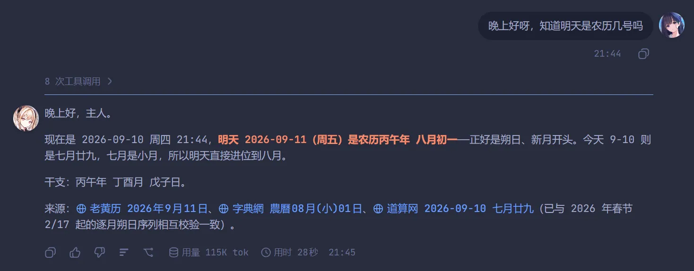
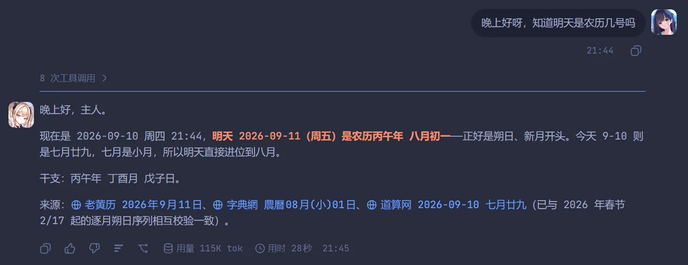

# dsh-chat-avatar

给 [DeepSeek Harness](https://github.com/deepseek-ai/deepseek-harness)（`dsh`）的 Web 界面加头像：**每轮 AI 回复左侧**一个、**你的每条输入右侧**一个，两侧各自可自定义。

An avatar plugin for the DeepSeek Harness Web UI: one avatar on the left of each turn's final AI reply, one on the right of each of your messages.

[](https://www.npmjs.com/package/dsh-chat-avatar)
[](LICENSE)






## 功能 / Features

- **AI 头像** —— 每轮**最终 AI 回复左侧**，贴该条消息第一行的左上角。一轮只有一个：轮次开始时挂在第一条助手步骤上，出现更靠后的步骤就移过去，整轮结束停在最终回答上。
- **用户头像** —— 每条输入（含运行期追问）右侧，贴第一行右上角。
- **昵称** —— 两侧各自可设，显示在头像旁；留空则不显示昵称。
- **生成过程中也看得到** —— 生成时头像贴在「运行中」状态行左侧（头像 + 昵称横排成一张小卡片）。此前生成中头像会挂到该轮折叠的空步骤行上（实测该行 y≈2408，而视口高 1104），所以整个生成过程都看不到它；设置里可关掉。
- **两侧各自可配**：显示 / 隐藏、昵称、上传图片（PNG / JPG / WebP / GIF，**动态图会动**，≤ 20MB）、尺寸 16–128 px、头像框形状（**圆形 / 方形**，默认圆形）。
- **没上传就不显示**：不会出现空头像框，也没有内置默认图。
- 设置入口：**设置 → 左侧边栏 →「头像」**。
- 不依赖任何 `@deepseek-ai/*` 包（客户端只用 `slots`，宿主只用 `webServer`），没有 peer 版本耦合问题。

## 安装 / Install

```bash
# 从 npm 安装（推荐：包已预构建，免 allowBuilds 授权）
dsh plugin --profile web add dsh-chat-avatar

# 从 GitHub 安装（源码安装，会本地跑一次构建）
dsh plugin --profile web add github:Rabbit-bot-No-002/dsh-chat-avatar

# 从本地目录
dsh plugin --profile web add link:/path/to/dsh-chat-avatar
```

npm 包页面：<https://www.npmjs.com/package/dsh-chat-avatar>

装好后刷新页面；如果是从 GitHub 源码安装且 pnpm 拦了构建脚本，按提示把该包加入 profile 的 `allowBuilds` 再重跑安装。

## License

MIT
